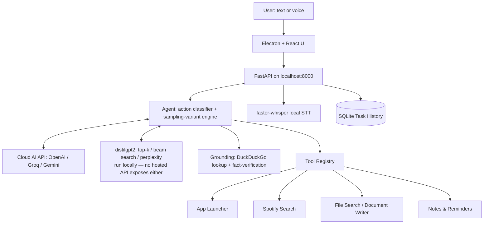
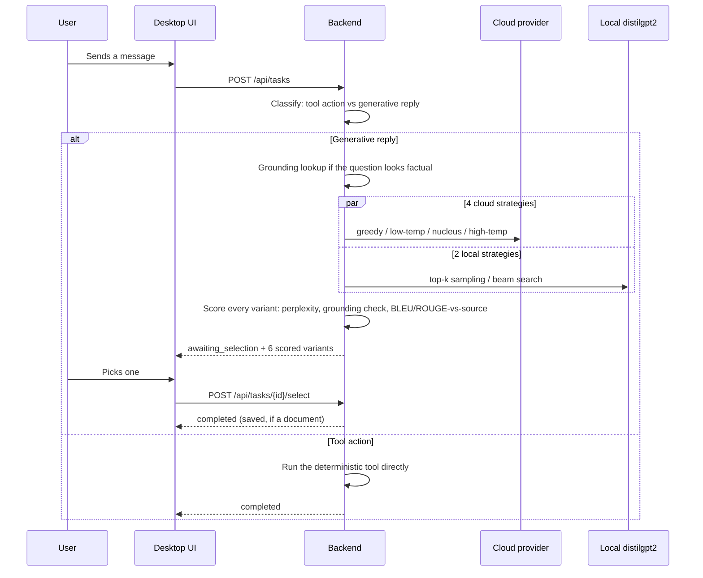

# AETHER — Desktop AI Assistant

AETHER is a Windows-first desktop assistant that routes natural-language commands to
controlled productivity tools. The assistant's own logic — action routing, tool
execution, file/notes/reminders handling, speech recognition — runs on your device.
Text generation (chat replies, document and code generation, action classification)
is produced by a pretrained large language model accessed through a cloud API; no
model weights are trained or run on-device for text generation — except for two
specific sampling strategies (top-k, beam search) that no hosted API exposes, which run
as real local decoding instead of being faked (see "Sampling strategies" below).

Three interchangeable API providers are supported — OpenAI, Groq, or Google Gemini —
selected with one setting (see `aether/backend/MODEL_SETUP.md`). Groq's free tier needs
no credit card and is the default.

The project lives under [`aether/`](aether/); this README covers the whole repo.

## How it works

Every generative reply (chat or document writing) is **not** auto-finalized. It runs 6
sampling strategies in parallel and pauses for a human pick:

Full component/sequence/state diagrams: [`aether/docs/ARCHITECTURE.md`](aether/docs/ARCHITECTURE.md).

## Features in this prototype
- ChatGPT-inspired Electron + React desktop chat UI, with Markdown rendering (tables,
  bold, headings, code blocks) for AI replies.
- LLM-based command understanding and document/code generation via a cloud AI API.
- **Every chat reply and document-writing request runs 6 sampling strategies in
  parallel and lets you pick which output to keep** — greedy, low-temperature,
  nucleus (top-p), and high-temperature via the live cloud model, plus **top-k
  sampling and beam search run as real local decoding** (not faked) since no hosted
  API exposes either.
- **Live per-response metrics** on every variant: perplexity (scored by a fixed local
  reference model), a source-grounding truthfulness check, and BLEU/ROUGE similarity
  to source material where one exists.
- **Playground page**: the same 6-strategy comparison as a standalone experiment, for
  any prompt you want to probe.
- **Offline evaluation harness** (`aether/backend/scripts/evaluate_generation.py`)
  aggregating BLEU/ROUGE/perplexity per strategy across a fixed prompt set, saved as
  timestamped runs under `aether/backend/eval_results/`.
- Keyless factual grounding (DuckDuckGo instant-answer lookup) plus a self-verification
  pass that catches the model stating a specific fact its source material doesn't
  actually contain, instead of surfacing it as a confident wrong answer.
- Local task history in SQLite.
- Notes saved as Markdown; reminders scheduled and displayed in the app.
- Allowlisted Windows app launching.
- Spotify search launch (internet/service account may be required).
- Filename search in Desktop, Documents and Downloads.
- DOCX/TXT/code-file document creation.
- Local speech-to-text using faster-whisper; read-aloud using the OS's speech synthesis.
- Settings page showing live AI API connection status.

## One-click setup (Windows 10/11)

1. Get a free API key — Groq (no card needed): https://console.groq.com/keys.
2. Double-click `aether/SETUP_AND_RUN.bat`. It installs missing Python 3.11/Node.js LTS
   (via winget), creates the Python environment, installs all project dependencies,
   and creates `aether/backend/.env` from `.env.example` if it doesn't exist yet.
3. Open `aether/backend/.env`, set `AETHER_PROVIDER` (default `groq`) and paste your key
   into the matching `*_API_KEY` line, then rerun `SETUP_AND_RUN.bat` (or
   `aether/START_AETHER.bat`).
4. For later launches, double-click `aether/START_AETHER.bat`.
5. (Optional, for the evaluation harness only) `pip install torch --index-url
   https://download.pytorch.org/whl/cpu` inside `aether/backend/.venv`.

Internet access is required every time AETHER generates text (it calls the configured
cloud API) — this is different from earlier prototypes of this project, which ran a
local Ollama model entirely offline. See `aether/backend/MODEL_SETUP.md` for provider
details and `aether/backend/.env.example` for every setting.

The setup scripts are in `aether/windows/`. The backend and desktop commands are
prewritten; you do not need to type them manually.

## Example commands
- `Play some relaxing music`
- `Take a note: Finish the project report`
- `Remind me to take a break in 20 minutes`
- `Open Calculator`
- `Find my resume`
- `Create a Word document about renewable energy`
- `Describe a sunset in one sentence` (try this one in the Playground to actually see
  the 6 strategies diverge — short factual questions tend to look identical across all
  of them)

## AI concepts
See [`aether/docs/PROJECT_REPORT.md`](aether/docs/PROJECT_REPORT.md) for the full
writeup. In short: AETHER uses pretrained Transformer-family LLMs (served by
OpenAI/Groq/Gemini) as a black box for text generation — this project does not
pretrain, fine-tune, or implement attention/MHA from scratch. What it demonstrates
instead is conditional text generation, a real comparison of 6 decoding/sampling
strategies (not just picking one and hiding the choice), correctly-scoped evaluation
metrics, grounding/fact-verification, structured action routing, and a basic agentic
workflow built on top of API-served models.

### Alignment with Quiz-1 syllabus
Honest mapping of what's actually implemented against the course's Quiz-1 topics —
useful context for the report, and for being accurate about what AETHER does and does
not cover:

| Syllabus topic | Covered by AETHER? | Where |
|---|---|---|
| GenAI meaning, capabilities, applications | Yes — AETHER *is* an applied GenAI system: text generation for essays/reports/letters/code, conversational Q&A, and an agent that decides which tool a request needs. | `app/services/agent.py`, `app/core/runner.py` |
| Tools for text/code generation | Yes, directly. | `write_document` action, multiple file formats |
| Tools for image/video/audio *generation* | No — attempted and dropped. Image generation was built but every image-capable model on OpenAI/Groq/Gemini returned $0 credits or a `0` free-tier quota; no provider in use offers free audio/video generation. Speech is input (STT) and output (OS TTS) only, not generated audio content. | — |
| Intro to LLMs, history/evolution | Not implemented in code — narrative only, in `docs/PROJECT_REPORT.md`. | `aether/docs/PROJECT_REPORT.md` |
| Transformer architecture (attention, pre-training, fine-tuning, MLM/NSP) | Not implemented — these models are pretrained by the API provider; AETHER never trains, fine-tunes, or touches model internals. | — |
| Data preprocessing, training strategies, fine-tuning on custom data | Not applicable — no training happens in this project. | — |
| Text generation techniques | Yes. | `agent.generate_text`, `agent.chat`, `agent.generate_variant_any` |
| **Conditional text generation** | Yes, throughout: every generation call conditions the model on a system prompt plus the user's instruction, and optionally on retrieved/attached source material (grounding context), not just a bare prompt. | `generate_text(instruction, context=...)`, `chat(message, context=...)` |
| **Sampling strategies (greedy / random / temperature / nucleus / top-k / beam)** | Yes — **all 6**, run side by side with a human pick, not just set internally and hidden. Greedy, low-temperature, nucleus (top-p), and high-temperature via the live cloud API. Top-k and beam search via a real local decode loop (Hugging Face Transformers' `generate()` on `distilgpt2`), since hosted chat-completions APIs reject both — confirmed directly against Groq: `top_k` → `400 unsupported property`; `n>1` (which beam search needs) → `400 must be at most 1`. | `agent.py` `SAMPLING_PRESETS` / `generate_variant_any` / `generate_document_variant`, `POST /api/compare`, `POST /api/tasks/{id}/select`, desktop Playground + inline chat picker |
| **Evaluation metrics for text generation (perplexity, BLEU, ROUGE)** | Yes, in two places: live per-response (every variant card shows perplexity + a grounding check + BLEU/ROUGE-vs-source when context exists), and offline as a real aggregate comparison across all 6 strategies over 9 prompts (see `docs/PROJECT_REPORT.md`'s Results section). Perplexity can't come from the live provider's own logprobs (Groq rejects the `logprobs` param outright — a hosted-API limitation, not a code gap), so it's scored by a fixed local reference model (`distilgpt2`) instead — the standard NLG-literature workaround. BLEU/ROUGE are never forced onto open-ended creative prompts that have no single correct reference. | `app/eval/metrics.py`, `app/core/variants.py`, `scripts/evaluate_generation.py`, `eval_results/` |

## Limitations
This is a prototype, not a finished commercial-grade JARVIS. It currently routes one
primary action per command. Spotify opens a search page; playback may require user
interaction. Reminders are displayed in AETHER but native Windows toast notifications
are not integrated. File search is filename-only. Speech model downloads happen on
first use. Generation quality and latency depend on the configured cloud provider and
your internet connection — provider model catalogs change without notice (hit twice
during development; see `aether/backend/MODEL_SETUP.md`'s reproducibility note). Image,
audio, and video generation are not available (see the syllabus table above). RAG
beyond simple keyless lookups, semantic memory, robust multi-step planning, wake word,
comprehensive browser automation, full UI control and a signed installer remain future
work.

## Safety
No arbitrary shell execution is exposed to the model. Application launching is
allowlisted. File search is read-only. No generative reply is saved or shown as final
until a human picks it from the 6 sampling variants. Generated documents and notes are
saved locally, with automatic de-duplication so an untitled document can never silently
overwrite another. API keys live only in the gitignored `aether/backend/.env` file and
are never sent anywhere except the configured provider's own API. Review important
outputs before relying on them — document/letter generation fills unknown personal
details with bracketed placeholders rather than inventing them, and factual chat
replies are grounded and cross-checked where possible, but no LLM-backed system is
immune to occasional mistakes.

## Academic presentation
- Project report: [`aether/docs/PROJECT_REPORT.md`](aether/docs/PROJECT_REPORT.md)
  (also `aether/docs/AETHER_Project_Report.pdf`/`.docx`, predates this round of work)
- Architecture + diagrams: [`aether/docs/ARCHITECTURE.md`](aether/docs/ARCHITECTURE.md)
- Test plan: [`aether/docs/TEST_CASES.md`](aether/docs/TEST_CASES.md)
- Demo script: [`aether/docs/DEMO_SCRIPT.md`](aether/docs/DEMO_SCRIPT.md)
- AI model/provider setup: [`aether/backend/MODEL_SETUP.md`](aether/backend/MODEL_SETUP.md)
- Evaluation results: [`aether/backend/eval_results/latest_summary.md`](aether/backend/eval_results/latest_summary.md)
