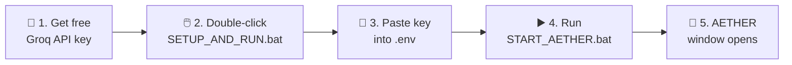
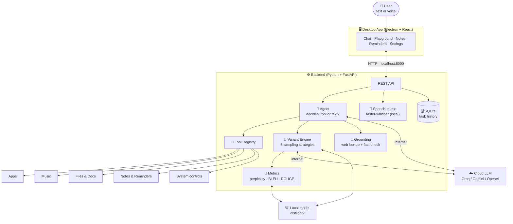
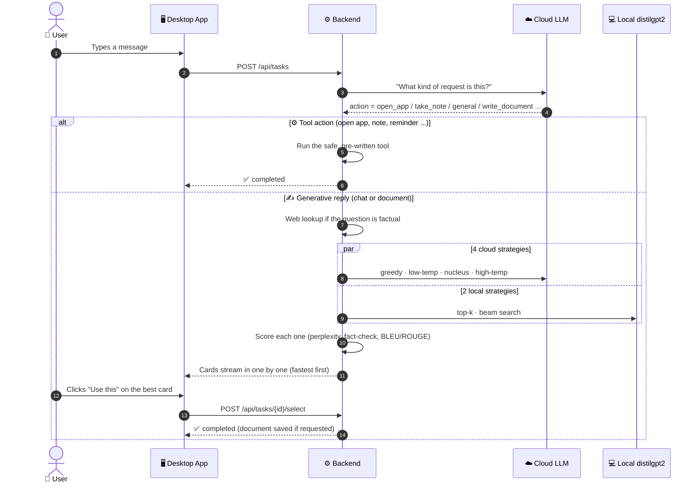
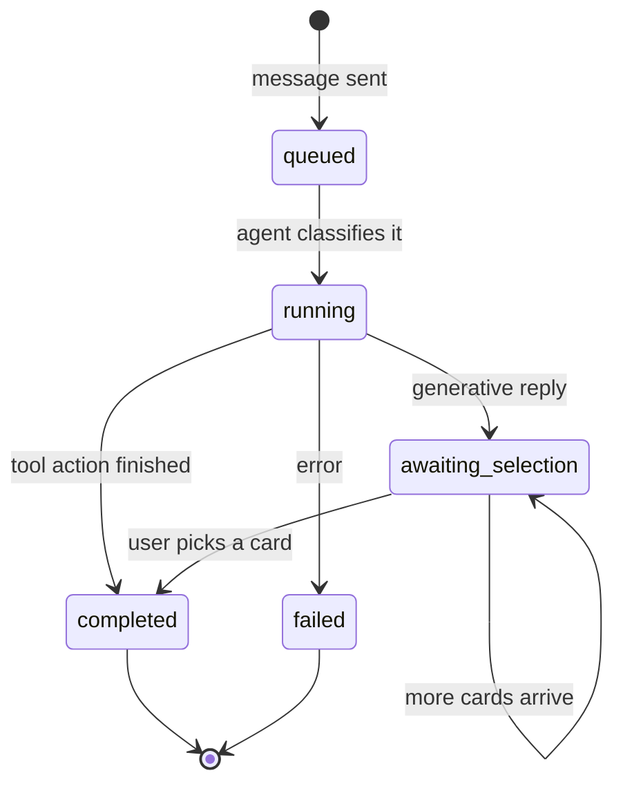
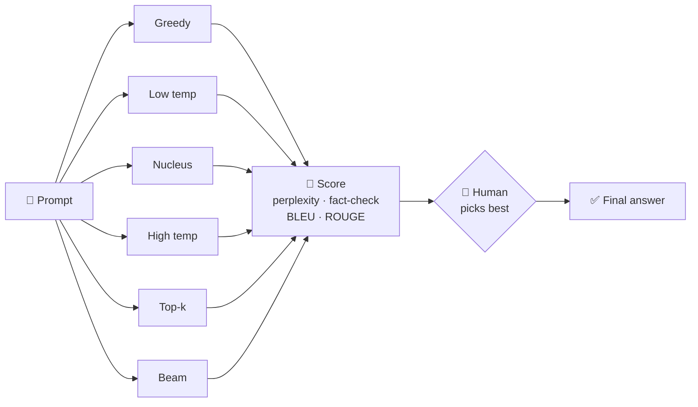
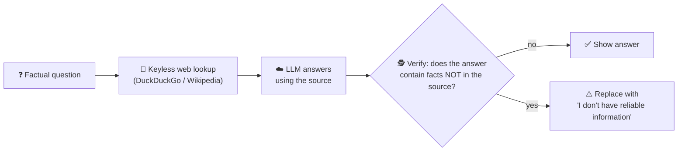
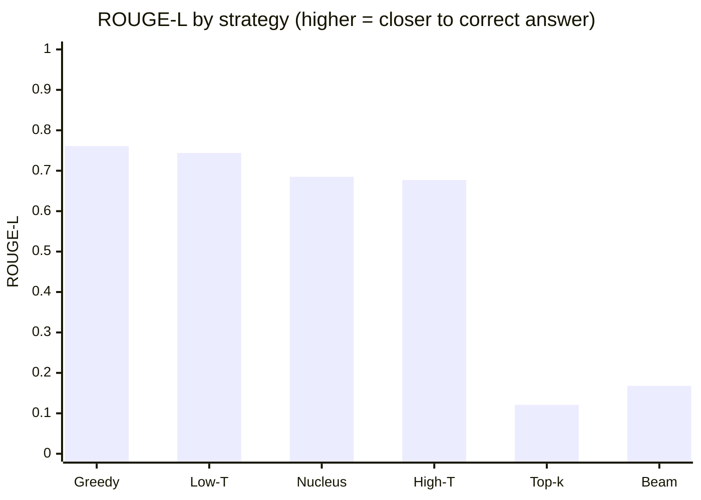

<div align="center">

# 🌌 AETHER

### A Windows desktop AI assistant that shows you *how* text generation works

**Type or speak a command → AETHER either does it (open an app, take a note, set a reminder)<br/>
or writes a reply using 6 different sampling strategies side by side, so you can see which one is best.**


📄 [Project Report (PDF)](docs/Report_05.pdf) · 🎞️ [Presentation (PDF)](docs/PPT_05.pdf) · 📊 [Evaluation Results](aether/backend/eval_results/latest_summary.md)

</div>

---

## 📑 Table of Contents

1. [Project at a Glance](#-1-project-at-a-glance)
2. [Quick Start (Setup in 5 Steps)](#-2-quick-start-setup-in-5-steps)
3. [How to Use AETHER](#-3-how-to-use-aether)
4. [Features](#-4-features)
5. [System Architecture](#-5-system-architecture)
6. [Project Report: The AI Behind AETHER](#-6-project-report-the-ai-behind-aether)
7. [Evaluation & Results](#-7-evaluation--results)
8. [Testing: Bugs Found and Fixed](#-8-testing-bugs-found-and-fixed)
9. [Syllabus Mapping](#-9-syllabus-mapping)
10. [Safety, Limitations & Future Work](#-10-safety-limitations--future-work)
11. [Project Structure & API Reference](#-11-project-structure--api-reference)
12. [Troubleshooting](#-12-troubleshooting)

---

## 🧭 1. Project at a Glance

| | |
|---|---|
| **What is it?** | A desktop assistant (like a mini JARVIS) for Windows. You chat with it in a ChatGPT-style window. |
| **What can it do?** | Open apps, play music, take notes, set reminders, search files, control volume/brightness/Wi-Fi, write documents and code, answer questions, generate images. |
| **What makes it special?** | Most chatbots secretly pick *one* way of generating text and hide it. AETHER runs **6 sampling strategies at the same time**, scores each one with real metrics (perplexity, BLEU, ROUGE, a fact-check), and lets **you** choose the best answer. |
| **Which AI does it use?** | A cloud Large Language Model (Groq, Google Gemini or OpenAI; Groq is free and the default) **plus** a small local model (`distilgpt2`) for the two strategies no cloud API offers (top-k and beam search). |
| **Tech stack** | Python 3.11 · FastAPI · SQLite · Hugging Face Transformers · PyTorch · faster-whisper · Electron · React · TypeScript · Vite |

> 💡 **In one sentence:** AETHER is an applied Generative-AI project that turns sampling strategies and evaluation metrics, usually hidden inside a model, into something you can see, compare and pick from.

---

## 🚀 2. Quick Start (Setup in 5 Steps)

### What you need

| Requirement | Do I need to install it myself? |
|---|---|
| Windows 10 or 11 | ✅ Yes |
| Internet connection | ✅ Yes (for setup and for every AI reply) |
| A free API key | ✅ Yes, takes 1 minute (Step 1) |
| Python 3.11, Node.js, all libraries | ❌ **No**, the setup script installs them for you |



### Step 1: Get a free API key
1. Go to **https://console.groq.com/keys** and sign up (Google sign-in works; no credit card needed).
2. Click **Create API Key**, give it any name, and **copy** the key (it starts with `gsk_`).
   Save it somewhere: Groq shows it only once.

### Step 2: Run the one-time setup
1. Open the project folder and go into the `aether` folder.
2. Double-click **[`aether/SETUP_AND_RUN.bat`](aether/SETUP_AND_RUN.bat)**.
3. Accept any Windows installer prompts. The script automatically:
   - installs **Python 3.11** and **Node.js** if they are missing (via `winget`)
   - creates a Python virtual environment and installs all Python libraries (including PyTorch)
   - installs all desktop-app (Node) libraries
   - creates your settings file `aether/backend/.env`

   ⏳ This takes **5–15 minutes** the first time. At the end it shows a yellow message asking you to add your API key. That is expected.

### Step 3: Add your API key
1. Open **`aether/backend/.env`** in Notepad.
2. Find the line `GROQ_API_KEY=` and paste your key right after the `=`:
   ```env
   AETHER_PROVIDER=groq
   GROQ_API_KEY=gsk_your_key_here
   ```
   No quotes, no spaces. Save the file.

> 🔒 **Keep this key private.** The `.env` file is already excluded from git. Never upload or share it.

### Step 4: Start AETHER
Double-click **[`aether/START_AETHER.bat`](aether/START_AETHER.bat)**. Two terminal windows open:

| Window | What it is | Ready when you see |
|---|---|---|
| Backend | The AI "brain" (FastAPI server on port 8000) | `Uvicorn running on http://127.0.0.1:8000` |
| Desktop | The app window (Electron + React) | The AETHER window appears |

**Keep both windows open** while using AETHER. Close them to stop it.

### Step 5: Every time after that
Just double-click **`aether/START_AETHER.bat`**. That's it.

> ⏱️ **First-use downloads:** your first chat reply downloads the small local model `distilgpt2` (~350 MB, one time only), so it is slower. The first voice command downloads the speech model the same way.

<details>
<summary><b>🛠️ Manual setup (for developers, or if the .bat files fail)</b></summary>

**Terminal 1: backend**
```powershell
cd aether\backend
py -3.11 -m venv .venv
.\.venv\Scripts\Activate.ps1
pip install -r requirements.txt
pip install torch --index-url https://download.pytorch.org/whl/cpu
copy .env.example .env        # then open .env and add your API key
uvicorn app.main:app --host 127.0.0.1 --port 8000
```

**Terminal 2: desktop app**
```powershell
cd aether\desktop
npm install
npm run dev
```

Check the backend is alive: open http://127.0.0.1:8000/health in a browser.
</details>

<details>
<summary><b>🔄 Using Google Gemini or OpenAI instead of Groq</b></summary>

All three providers can stay in `.env` at the same time. Switch with one line:

```env
AETHER_PROVIDER=gemini          # groq | gemini | openai
GROQ_API_KEY=gsk_...
GEMINI_API_KEY=AIzaSy...
OPENAI_API_KEY=sk-...
```

| Provider | Free? | Get a key |
|---|---|---|
| Groq (default) | ✅ Free, no card | https://console.groq.com/keys |
| Google Gemini | ✅ Free, no card | https://aistudio.google.com/apikey |
| OpenAI | ❌ Paid | https://platform.openai.com/api-keys |

Restart the backend after changing `.env`. More details: [`aether/backend/MODEL_SETUP.md`](aether/backend/MODEL_SETUP.md).
</details>

---

## 💬 3. How to Use AETHER

Type into the chat box (or click the 🎤 microphone and speak). Try these:

| You type… | What happens | Type |
|---|---|---|
| `Open Calculator` | Opens the Windows Calculator | ⚙️ Tool action |
| `Play some relaxing music` | Searches and opens music on YouTube / Spotify | ⚙️ Tool action |
| `Take a note: Finish the project report` | Saves a note (see the **Notes** page) | ⚙️ Tool action |
| `Remind me to take a break in 20 minutes` | Schedules a reminder (see the **Reminders** page) | ⚙️ Tool action |
| `Find my resume` | Searches Desktop, Documents and Downloads by filename | ⚙️ Tool action |
| `Turn the volume up` / `Lock my PC` | Controls your computer | ⚙️ Tool action |
| `Generate an image of a mountain at sunset` | Creates and saves an image | ⚙️ Tool action |
| `Create a Word document about renewable energy` | Writes a `.docx` using **6 strategies**, you pick one, then it's saved | ✍️ Generative |
| `What is the capital of France?` | Answers, fact-checked against a web lookup | ✍️ Generative |
| `Describe a sunset in one sentence` | Best prompt to **see the 6 strategies differ** | ✍️ Generative |

### The app's pages

| Page | What it's for |
|---|---|
| 💬 **Assistant** | Main chat. Generative replies show 6 cards; click **Use this** on the one you like. |
| 🧪 **Playground** | Type any prompt and compare all 6 strategies with their scores. Nothing is saved. Ideal for evaluation. |
| 📝 **Notes** | View, edit and delete saved notes. |
| ⏰ **Reminders** | See upcoming and due reminders. |
| ⚙️ **Settings** | Shows whether the AI API is connected and which model is in use. |

> 📎 You can also **attach files** (`.pdf`, `.docx`, `.txt`, `.md`, `.csv`, `.json`, code files) and ask questions about them. The file's text is used as context for the answer.

---

## ✨ 4. Features

<table>
<tr>
<td width="50%" valign="top">

**🧠 Generative AI**
- 6 sampling strategies per reply, run in parallel
- 5 ranked candidates for nucleus, top-k and beam
- Live metrics on every answer: perplexity, fact-check, BLEU/ROUGE
- Playground page for side-by-side experiments
- Offline evaluation script with saved results
- Fact grounding with a web lookup + self-verification
- Write documents and code (`.docx`, `.txt`, `.md`, `.py`, `.js`, `.html` and more)
- Ask questions about attached files

</td>
<td width="50%" valign="top">

**🖥️ Desktop assistant**
- ChatGPT-style chat UI with Markdown (tables, code blocks)
- Open allow-listed apps (Calculator, Notepad, Chrome, VS Code…)
- Play music on YouTube / Spotify
- Notes saved as Markdown files
- Reminders with a scheduler
- File search (Desktop, Documents, Downloads)
- Volume, brightness, Wi-Fi, lock, sleep, screenshot
- Voice input (local speech-to-text) and read-aloud
- Image generation (free Pollinations API)
- Chat history saved locally (SQLite)

</td>
</tr>
</table>

---

## 🏗️ 5. System Architecture

### 5.1 Big picture

AETHER has two halves that talk over HTTP on your own computer: a **desktop app** (what you see) and a **backend** (the brain).



| Runs on **your PC** | Runs in the **cloud** |
|---|---|
| App UI, task routing, all tools, notes, reminders, file search, speech-to-text, task history, `distilgpt2` (top-k, beam search, perplexity scoring) | Main text generation by the LLM (greedy, low-temp, nucleus, high-temp), and classifying what a command means |

### 5.2 What happens when you send a message



### 5.3 Life of a task



> 🧑‍⚖️ **Human in the loop:** no generated text is ever saved or treated as final until a person picks it.

---

## 📘 6. Project Report: The AI Behind AETHER

> The full report is in [`docs/Report_05.pdf`](docs/Report_05.pdf). This section summarises it.

### 6.1 Problem statement

Language models don't produce text in a single fixed way. At every step they produce a **probability for every possible next word (token)**, and a **sampling strategy** decides which one to pick. The choice of strategy changes the answer: it can be more accurate, more creative, more repetitive or more wrong. Normal chatbots hide this choice.

**Goal:** build a useful assistant that also **makes this choice visible**: run several strategies at once, measure each output, and let a human decide.

### 6.2 Approach



1. **Conditional text generation:** every request is conditioned on a system prompt + the user's instruction + (optionally) retrieved facts or an attached file.
2. **6 sampling strategies** run in parallel (table below).
3. **Automatic scoring** of every output.
4. **Human selection** of the final answer.

### 6.3 The 6 sampling strategies

| # | Strategy | Settings | Where it runs | In one line | Best for |
|---|---|---|---|---|---|
| 1 | **Greedy decoding** | temperature = 0 | ☁️ Cloud | Always picks the single most likely next token | Facts, consistency |
| 2 | **Low-temperature** | T = 0.3 | ☁️ Cloud | Mostly safe choices, slight variety | Reliable answers |
| 3 | **Nucleus (top-p)** | T = 0.8, p = 0.9 | ☁️ Cloud | Picks from the smallest set of tokens covering 90% probability | Natural, balanced text |
| 4 | **High-temperature** | T = 1.0 | ☁️ Cloud | Flattens probabilities, so unlikely tokens get a chance | Creativity (riskier) |
| 5 | **Top-k** | k = 50 | 💻 Local | Picks only from the 50 most likely tokens | Comparison with top-p |
| 6 | **Beam search** | 5 beams | 💻 Local | Tracks the 5 best whole sentences, not one word at a time | Shows beam search's repetition problem |

<details>
<summary><b>📖 Click for the theory behind each strategy (beginner-friendly)</b></summary>

Imagine the model has just written *"The sky is"* and must choose the next word. It might think: **blue 60%**, clear 20%, dark 10%, falling 0.1%, …

- **Greedy decoding:** always take the top word (*blue*). Fully deterministic: the same prompt always gives the same answer. Good for factual recall, but it can get stuck in bland, repetitive phrasing because it never explores alternatives.

- **Temperature sampling:** before picking, the scores are divided by a *temperature* T.
  - **Low T (→ 0)** sharpens the distribution: *blue* becomes even more likely, so it behaves like greedy. Better for **accuracy**.
  - **High T (> 1)** flattens it: *falling* gets a real chance. Better for **creativity**, but this is also what makes the model invent wrong facts.

- **Nucleus (top-p) sampling:** sort words by probability and keep only the smallest group whose probabilities add up to *p* (here 90%), then sample from that group. The group **adapts**: it is small when the model is confident and larger when it's unsure. This avoids greedy's rigidity *and* temperature sampling's occasional pick from the very unlikely long tail.

- **Top-k sampling:** the fixed-size version: always keep exactly the *k* (here 50) most likely words. Simpler than top-p, but it doesn't adapt. 50 may be too many when the model is sure, or too few when it isn't.

- **Beam search:** not random at all. It keeps the **5 most probable whole sentences** at every step and keeps extending only those. AETHER shows **all 5 final beams** ranked by their real probability. On a small model they are often nearly identical and repetitive, a well-known real weakness of beam search ("lack of diversity") that you can see directly in the app.

</details>

### 6.4 Why are top-k and beam search run locally?

Hosted chat APIs **do not allow** them. This was tested directly against Groq:

| Requested | API response |
|---|---|
| `top_k` parameter | `400 unsupported property` |
| `n > 1` (several outputs, needed for beam search) | `400 'n' must be at most 1` |

So instead of faking them, AETHER runs **real** top-k and beam search with Hugging Face's `generate()` on the small open model **`distilgpt2`** on your own CPU.

### 6.5 Five ranked candidates, not just one

For nucleus, top-k and beam search, each card shows its best answer **plus all 5 candidates** it produced (click *"5 ranked candidates"*). You can pick any of them, not only the top one.

| Strategy | How the 5 candidates are ranked |
|---|---|
| Beam search | The 5 real beams, by the model's true sequence log-probability |
| Top-k | 5 independent samples, by the local model's true log-probability |
| Nucleus | 5 independent cloud samples, by perplexity under `distilgpt2`, a clearly labelled *proxy*, because cloud APIs don't expose their own probabilities |

### 6.6 Evaluation metrics shown on every answer

| Metric | What it measures | Lower or higher is better? | How AETHER computes it |
|---|---|---|---|
| **Perplexity** | How "surprised" a language model is by the text, i.e. its fluency or predictability | ⬇️ Lower = more predictable | Scored by a fixed local model (`distilgpt2`), because cloud APIs refuse to return log-probabilities (`logprobs` → `400`) |
| **BLEU** | Word/phrase overlap with a reference answer (0–100) | ⬆️ Higher = closer to reference | `sacrebleu` |
| **ROUGE-L** | Longest shared word sequence with a reference (0–1) | ⬆️ Higher = closer to reference | `rouge-score` |
| **Grounding check** | Does the answer state facts that are *not* in the looked-up source? | ✅ / ⚠️ | A second LLM pass compares the answer against the source |

> ⚠️ BLEU/ROUGE are only used when there is **one correct reference answer** (facts, summaries). They are deliberately **not** applied to open-ended prompts like poems or essays, where they would be meaningless.

### 6.7 Grounding: reducing made-up facts



---

## 📊 7. Evaluation & Results

The script [`aether/backend/scripts/evaluate_generation.py`](aether/backend/scripts/evaluate_generation.py) ran **9 test prompts** (5 factual questions, 2 summaries, 1 essay, 1 poem) through **all 6 strategies** and scored every output.

| Strategy | Mean Perplexity ⬇️ (n=9) | Mean BLEU ⬆️ (n=7) | Mean ROUGE-L ⬆️ (n=7) |
|---|---:|---:|---:|
| Greedy decoding | 1539.82 | 32.89 | **0.761** |
| Low-temperature sampling | 1540.28 | 32.78 | 0.744 |
| Nucleus (top-p) sampling | 1512.81 | 31.42 | 0.685 |
| High-temperature sampling | 815.72 | **35.08** | 0.677 |
| Top-k sampling (local) | 19.61 | 4.14 | 0.121 |
| Beam search, 5 beams (local) | **8.82** | 5.31 | 0.168 |

<sub>Source: [`eval_results/run_20261117T070315Z.json`](aether/backend/eval_results/run_20261117T070315Z.json) · summary: [`latest_summary.md`](aether/backend/eval_results/latest_summary.md)</sub>



### What the results mean

| Observation | Explanation |
|---|---|
| 🥇 **Greedy and low-temperature score the best ROUGE-L** | For questions with one right answer, the most likely tokens are usually the correct ones. |
| 🎲 **High temperature scored the highest BLEU** in this run | BLEU is sensitive to exact phrasing on short answers, so a single lucky sample can push it up. That is why we report both BLEU *and* ROUGE. |
| 📉 **Top-k and beam have the *lowest* perplexity but the *worst* BLEU/ROUGE** | They use a tiny local model that finds its *own* repetitive text very predictable. **Fluent ≠ correct.** |
| 🤔 **Greedy's perplexity is higher than high-temperature's** | The scoring model finds confident, specific facts more "surprising" than vague text. **Perplexity alone can't measure truthfulness**, which is why the grounding check exists. |

> 🎓 **Key takeaway:** no single metric tells the full story, and no single sampling strategy is best for every task. That is exactly why AETHER shows all of them and lets a human decide.

<details>
<summary><b>🔁 How to re-run the evaluation yourself</b></summary>

With the backend running (Step 4), open a new terminal:

```powershell
cd aether\backend
.\.venv\Scripts\Activate.ps1
$env:PYTHONPATH="."; python scripts\evaluate_generation.py
```

Each run is saved as `eval_results/run_<timestamp>.json` (older runs are kept) and `eval_results/latest_summary.md` is refreshed. If every request fails (backend off or invalid key) the script stops without overwriting the previous summary.
</details>

---

## 🧪 8. Testing: Bugs Found and Fixed

The variant picker was stress-tested with many simultaneous requests across task types (essay, email, poster, general knowledge, math). Three real bugs were found and fixed:

| # | Bug | Root cause | Fix |
|---|---|---|---|
| 1 | The UI froze after showing only 1 of 6 cards | A `NaN` perplexity score: `math.exp(nan)` returns `nan` instead of raising, and JSON can't encode `NaN`, so every later request returned HTTP 500 | Explicit NaN check in `metrics.perplexity` + a `_finite_or_none` scrub in `variants.py` |
| 2 | Beam/top-k cards were empty for document requests | The local model's prompt ended with a blank line, so `distilgpt2` just produced more blank lines | Anchored the prompt with `"Draft:"`, added a minimum token count, and a visible placeholder |
| 3 | Raw `429 Too Many Requests` error text appeared in a card | 30+ parallel calls exceeded the free-tier rate limit | 5 retries with exponential backoff that respects the `Retry-After` header, plus a friendly message |

✅ **Verified after the fixes:** essay, email, poster, general-knowledge and math prompts each produced all 6 readable cards, with every candidate selectable, under the same heavy load that broke it before.

---

## 🎓 9. Syllabus Mapping

An honest mapping of the course topics to what AETHER does and doesn't implement:

| Syllabus topic | Covered? | Where in the code |
|---|:---:|---|
| GenAI meaning, capabilities, applications | ✅ | The whole app: text/code generation, Q&A, an agent that chooses tools. `app/services/agent.py`, `app/core/runner.py` |
| Tools for text / code generation | ✅ | `write_document` action, multiple file formats, `app/tools/files.py` |
| Tools for image generation | 🟡 Partial | `app/tools/imaging.py` uses the free Pollinations API (the LLM providers had no free image quota) |
| Audio / video generation | ❌ | Not available for free from any provider used. Speech is input (STT) and read-aloud (OS TTS) only |
| Intro to LLMs, history & evolution | 📄 Report only | [`docs/Report_05.pdf`](docs/Report_05.pdf) |
| Transformer architecture, pre-training, fine-tuning | ❌ | Models are pretrained by the provider. AETHER does not train or modify model weights |
| **Conditional text generation** | ✅ | Every call is conditioned on a system prompt + instruction + optional context: `generate_text(instruction, context=…)`, `chat(message, context=…)` |
| **Sampling strategies** (greedy, temperature, nucleus, top-k, beam) | ✅ **All 6** | `SAMPLING_PRESETS` in `app/services/agent.py`, `app/core/variants.py`, `app/eval/metrics.py`, Playground page |
| **Evaluation metrics** (perplexity, BLEU, ROUGE) | ✅ | Live on every card + offline harness: `app/eval/metrics.py`, `scripts/evaluate_generation.py`, `eval_results/` |

---

## 🛡️ 10. Safety, Limitations & Future Work

### Safety by design
- 🚫 **The AI never runs shell commands.** It can only choose from pre-written, safe tools.
- 📋 **App launching is allow-listed.** Only known apps can be opened.
- 👁️ **File search is read-only.**
- 🧑‍⚖️ **Human-in-the-loop:** no generated text is saved until a person picks it.
- 🗂️ **No overwrites:** generated files get unique names automatically.
- 🔑 **API keys stay local** in the git-ignored `.env` file and are sent only to the chosen provider.
- ✍️ Letters/documents use `[placeholders]` for unknown personal details instead of inventing them.

### Current limitations
| Limitation | Details |
|---|---|
| One action per command | "Open Chrome and play music" runs only one of them |
| Allow-listed apps only | Apps not on the list (e.g. WhatsApp) are not opened |
| Internet required | Every AI reply calls a cloud API |
| Free-tier limits | Heavy use can hit rate limits (handled with retries) |
| Provider models change | A provider may retire a model; set `AETHER_MODEL` in `.env` to a current one |
| Reminders | Shown inside AETHER, not as native Windows notifications |
| File search | By filename only, not file contents |
| Development build | No signed single-file installer yet |

### Future work
Multi-step planning (several actions per command) · automatic fallback between AI providers · semantic memory / full RAG over your files · wake word ("Hey Aether") · native Windows notifications · signed installer.

---

## 📁 11. Project Structure & API Reference

```text
.
├── README.md                     ← you are here
├── docs/
│   ├── Report_05.pdf             ← full project report
│   └── PPT_05.pdf                ← presentation slides
└── aether/
    ├── SETUP_AND_RUN.bat         ← one-time setup (double-click)
    ├── START_AETHER.bat          ← start the app (double-click)
    ├── windows/                  ← PowerShell scripts behind the .bat files
    ├── backend/                  ← Python · FastAPI
    │   ├── .env.example          ← settings template (copy to .env)
    │   ├── MODEL_SETUP.md        ← AI provider details
    │   ├── requirements.txt
    │   ├── app/
    │   │   ├── main.py           ← server entry point
    │   │   ├── config.py         ← settings & provider selection
    │   │   ├── api/routes.py     ← all HTTP endpoints
    │   │   ├── services/agent.py ← LLM calls, classifier, sampling presets
    │   │   ├── core/runner.py    ← task pipeline (tool vs generative)
    │   │   ├── core/variants.py  ← runs & scores the 6 strategies
    │   │   ├── core/database.py  ← SQLite task history
    │   │   ├── eval/metrics.py   ← perplexity, BLEU, ROUGE, top-k, beam
    │   │   └── tools/            ← apps, music, files, notes, reminders,
    │   │                           grounding, attachments, images, browser
    │   ├── scripts/evaluate_generation.py ← offline evaluation
    │   └── eval_results/         ← saved evaluation runs
    └── desktop/                  ← Electron · React · TypeScript
        ├── electron/main.cjs     ← desktop window
        └── src/App.tsx           ← the whole UI
```

<details>
<summary><b>🔌 Backend API endpoints</b> (base URL <code>http://127.0.0.1:8000</code>)</summary>

| Method | Endpoint | Purpose |
|---|---|---|
| `GET` | `/health` | Is the backend running? |
| `GET` | `/api/status` | AI provider, model, connection status |
| `POST` | `/api/tasks` | Send a command / message |
| `GET` | `/api/tasks` · `/api/tasks/{id}` | Task history · one task (with its variants) |
| `POST` | `/api/tasks/{id}/select` | Pick the final variant (and candidate) |
| `GET` | `/api/sampling-presets` | List the 6 strategies |
| `POST` | `/api/compare` · `GET /api/compare/{job_id}` | Playground: run & poll all 6 strategies |
| `POST` | `/api/attachments` | Upload a file to use as context |
| `GET/POST/PUT/DELETE` | `/api/notes…` | Notes |
| `GET/POST/PATCH/DELETE` | `/api/reminders…` | Reminders |
| `GET/PUT` | `/api/documents/{name}` | Read / edit a generated document |
| `POST` | `/api/transcribe` | Speech-to-text |
| `GET` | `/files/{name}` | Download generated files |

Interactive docs (auto-generated by FastAPI): http://127.0.0.1:8000/docs
</details>

---

## 🧯 12. Troubleshooting

| Problem | Solution |
|---|---|
| App says **"AI API isn't reachable"** | Your API key is missing or wrong in `aether/backend/.env`. Check `AETHER_PROVIDER` matches the key you filled in, then restart. |
| Top-k / beam cards show **`No module named 'torch'`** | Run in `aether\backend`: `.\.venv\Scripts\python.exe -m pip install torch --index-url https://download.pytorch.org/whl/cpu` |
| **`Electron failed to install correctly`** | Delete `aether\desktop\node_modules` and run `npm install` again. If it still fails, install **Node.js 22 LTS** (very new Node versions can break Electron's installer). |
| **`running scripts is disabled on this system`** | Open PowerShell and run `Set-ExecutionPolicy -Scope CurrentUser RemoteSigned` once. |
| **`404 Not Found`** from the AI | The provider retired the default model. Add `AETHER_MODEL=<current model name>` to `.env` (see the provider's model list). |
| **`rate-limited`** message | Free-tier limit reached. Wait a few seconds and try again. |
| Port 8000 / 5173 already in use | Close old AETHER terminal windows (or restart the PC). |
| The app window doesn't open from VS Code's terminal | Start it by double-clicking `START_AETHER.bat` instead. |
| First reply is very slow | One-time download of `distilgpt2` (~350 MB). Later replies are fast. |

---

<div align="center">

📄 [Report](docs/Report_05.pdf) · 🎞️ [Slides](docs/PPT_05.pdf) · ⚙️ [Model setup](aether/backend/MODEL_SETUP.md) · 📊 [Results](aether/backend/eval_results/latest_summary.md)

</div>
