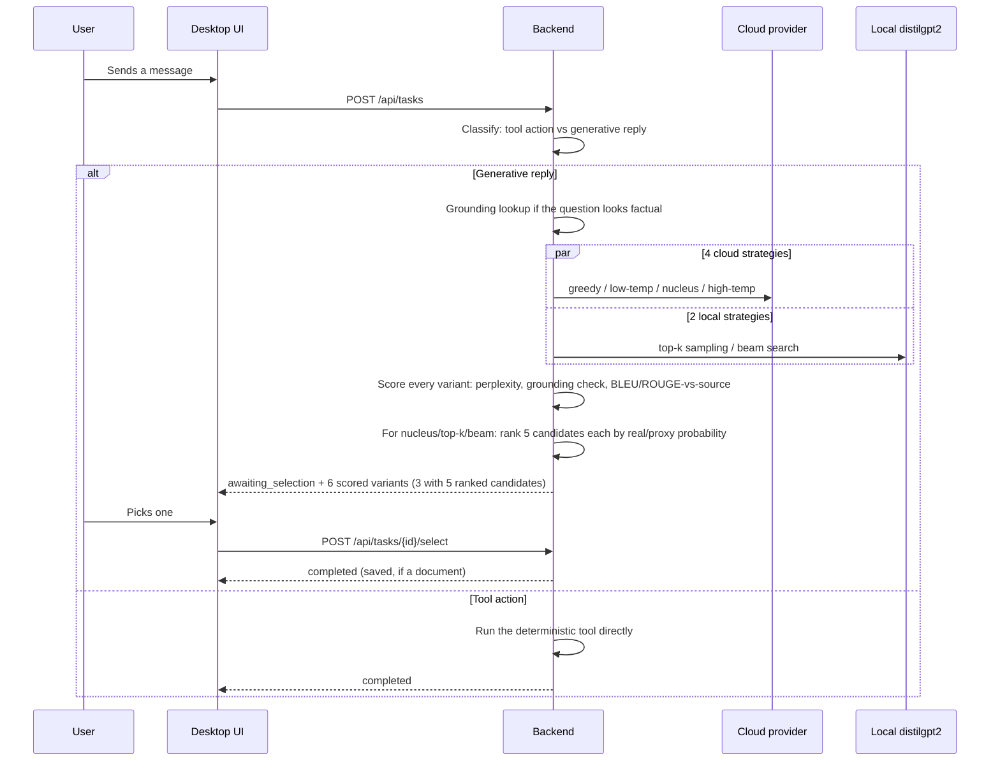

# AETHER - Desktop AI Assistant

AETHER is a Windows-first desktop assistant that routes natural-language commands to
controlled productivity tools. The assistant's own logic - action routing, tool
execution, file/notes/reminders handling, speech recognition - runs on your device.
Text generation (chat replies, document and code generation, action classification)
is produced by a pretrained large language model accessed through a cloud API; no
model weights are trained or run on-device for text generation - except for two
specific sampling strategies (top-k, beam search) that no hosted API exposes, which run
as real local decoding instead of being faked (see "Sampling strategies" below).

Three interchangeable API providers are supported - OpenAI, Groq, or Google Gemini - 
selected with one setting (see `aether/backend/MODEL_SETUP.md`). Groq's free tier needs
no credit card and is the default.

The project lives under [`aether/`](aether/); this README covers the whole repo.

## Quick start - run this on a fresh Windows PC

No Python, Node.js, or anything else needs to be installed beforehand - the setup
script installs every prerequisite itself. This works from a brand-new copy of this
repo (clone or ZIP download) on any Windows 10/11 machine.

1. **Get a free AI API key** - Groq (no credit card required): https://console.groq.com/keys
   (sign up, then "Create API Key").
2. **Double-click [`aether/SETUP_AND_RUN.bat`](aether/SETUP_AND_RUN.bat).**
   It automatically installs Python 3.11 and Node.js LTS if they're missing (via
   winget), creates the Python virtual environment, installs every Python and Node
   dependency, and creates `aether/backend/.env` from the template. Accept any
   Windows/winget install prompts that appear. This step needs an internet connection
   and can take a few minutes the first time.
3. **Add your API key.** Open `aether/backend/.env` in Notepad, set `AETHER_PROVIDER`
   (leave as `groq` to match step 1) and paste your key into `GROQ_API_KEY=`, then save.
4. **Rerun [`aether/SETUP_AND_RUN.bat`](aether/SETUP_AND_RUN.bat)** (or double-click
   [`aether/START_AETHER.bat`](aether/START_AETHER.bat)). Two terminal windows open
   (backend + desktop) and the AETHER window launches a few seconds later.
5. **For every later run**, just double-click `aether/START_AETHER.bat` - keep both
   terminal windows open while using the app; closing them stops AETHER.

Full plain-text version of these same steps: [`aether/windows/README_FIRST_RUN.txt`](aether/windows/README_FIRST_RUN.txt).
Troubleshooting, provider details (OpenAI/Groq/Gemini), and every `.env` setting:
[`aether/backend/MODEL_SETUP.md`](aether/backend/MODEL_SETUP.md).

## How it works

Every generative reply (chat or document writing) is **not** auto-finalized. It runs 6
sampling strategies in parallel and pauses for a human pick:

Full architecture write-up: [`docs/Report_05.pdf`](docs/Report_05.pdf).

## Features in this prototype
- ChatGPT-inspired Electron + React desktop chat UI, with Markdown rendering (tables,
  bold, headings, code blocks) for AI replies.
- LLM-based command understanding and document/code generation via a cloud AI API.
- **Every chat reply and document-writing request runs 6 sampling strategies in
  parallel and lets you pick which output to keep** - greedy, low-temperature,
  nucleus (top-p), and high-temperature via the live cloud model, plus **top-k
  sampling and beam search run as real local decoding** (not faked) since no hosted
  API exposes either.
- **5 ranked candidates, not just 1, for nucleus/top-k/beam.** Beam search surfaces
  the actual 5 hypotheses it tracked internally, ranked by the local model's real
  sequence log-probability. Top-k fires 5 independent samples, each ranked the same
  way. Nucleus (cloud-based) fires 5 independent samples too, ranked by perplexity
  under the local reference scorer - a clearly-labeled *proxy*, since the cloud
  provider doesn't expose its own token probabilities at all. Expandable inline on
  every variant card, in both the Playground and the main chat picker.
- **Live per-response metrics** on every variant: perplexity (scored by a fixed local
  reference model), a source-grounding truthfulness check, and BLEU/ROUGE similarity
  to source material where one exists.
- **Playground page**: the same 6-strategy comparison as a standalone experiment, for
  any prompt you want to probe.
- **Offline evaluation harness** (`aether/backend/scripts/evaluate_generation.py`)
  aggregating BLEU/ROUGE/perplexity per strategy across a fixed prompt set, saved as
  timestamped runs under `aether/backend/eval_results/`.
- Keyless factual grounding (DuckDuckGo instant-answer lookup) plus a self-verification
  pass that catches the model stating a specific fact its source material doesn't
  actually contain, instead of surfacing it as a confident wrong answer.
- Local task history in SQLite.
- Notes saved as Markdown; reminders scheduled and displayed in the app.
- Allowlisted Windows app launching.
- Spotify search launch (internet/service account may be required).
- Filename search in Desktop, Documents and Downloads.
- DOCX/TXT/code-file document creation.
- Local speech-to-text using faster-whisper; read-aloud using the OS's speech synthesis.
- Settings page showing live AI API connection status.

## Example commands
- `Play some relaxing music`
- `Take a note: Finish the project report`
- `Remind me to take a break in 20 minutes`
- `Open Calculator`
- `Find my resume`
- `Create a Word document about renewable energy`
- `Describe a sunset in one sentence` (try this one in the Playground to actually see
  the 6 strategies diverge - short factual questions tend to look identical across all
  of them)

## AI concepts
See the project report [`docs/Report_05.pdf`](docs/Report_05.pdf) for the full
writeup. In short: AETHER uses pretrained Transformer-family LLMs (served by
OpenAI/Groq/Gemini) as a black box for text generation - this project does not
pretrain, fine-tune, or implement attention/MHA from scratch. What it demonstrates
instead is conditional text generation, a real comparison of 6 decoding/sampling
strategies (not just picking one and hiding the choice), correctly-scoped evaluation
metrics, grounding/fact-verification, structured action routing, and a basic agentic
workflow built on top of API-served models.

### The theory behind the 6 sampling strategies
What each one actually does, and why it behaves the way it does in the Playground/chat
picker:

- **Greedy decoding** - at every step, pick the single highest-probability next token.
  Fully deterministic: the same prompt always produces the same output. Reliable for
  factual recall (the most likely token is usually the consensus-correct one), but can
  get stuck in bland or repetitive phrasing since it never considers an alternative
  that might lead somewhere better.
- **Temperature sampling** - before sampling, the model's raw output scores are divided
  by a temperature T and turned back into probabilities. T→0 sharpens the distribution
  until it behaves like greedy decoding; T>1 flattens it, making unlikely tokens
  relatively more probable. **This is why low temperature is better for factual
  accuracy and high temperature is better for creative diversity**: low T keeps
  picking what the model already finds most likely (usually correct, for a question
  with one right answer); high T deliberately makes less-likely tokens competitive,
  which is exactly what also makes it start inventing wrong specifics.
- **Nucleus (top-p) sampling** - sort tokens by probability and keep only the smallest
  set whose combined probability reaches p (e.g. 90%), then sample from just that set.
  Unlike a fixed cutoff, this pool size adapts automatically: small when the model is
  confident (behaves close to greedy), larger when it's genuinely uncertain - avoiding
  both pure greedy's rigidity and plain temperature sampling's occasional pick from the
  very unlikely long tail. AETHER fires 5 independent samples at this preset and shows
  all 5, ranked by a local perplexity proxy (the cloud provider exposes no real
  probability to rank by) - the top-ranked one becomes the card's headline answer.
- **Top-k sampling** - the fixed-size version of the same idea: only ever consider the
  k most likely tokens (here, 50), regardless of how peaked or flat the actual
  distribution is. Simpler than top-p, but less adaptive - a fixed k can be too narrow
  when the model is very confident, or too wide when it's genuinely unsure. AETHER
  samples 5 independent completions and shows all 5 ranked by the local model's own
  real log-probability (not a proxy, since this runs on-device).
- **Beam search** - not sampling at all, but a deterministic search: instead of
  committing to one best token per step, it tracks the **5** most probable whole
  sequences in parallel at every step and keeps expanding only those. AETHER shows
  **all 5 of those final hypotheses, ranked by real sequence log-probability** (not
  just the single winner), so you can see directly that they usually all converge on
  near-identical phrasing - on a small, non-instruction-tuned model, the
  highest-probability sequence overall is often the most generic/repeated one, and
  the next 4 right behind it tend to be minor variations of the same loop. That's a
  textbook real failure mode of beam search (lack of diversity among top candidates),
  reproduced directly in this project's own output, not a bug in the implementation.

### Progressive variant display and candidate-level selection
The chat picker and the Playground both start all 6 strategies at once but never make
the user wait for the slowest one before showing anything. The backend streams each
strategy's finished card to the frontend the moment it completes (the 4 cloud presets
typically land within a couple of seconds; top-k and beam, which run locally on
distilgpt2, land a few seconds later), so the UI fills in card by card, fastest first,
instead of blocking on a single batched response. This also cuts perceived latency: the
composer unblocks as soon as the first card is ready, so a new message can be sent while
the rest of the current one is still streaming in behind it.

For top-k, beam, and nucleus, each card's main answer is only the top-ranked one of 5
real candidates that strategy actually produced. Every card exposes all 5 behind a
"ranked candidates" disclosure, and in the chat picker each individual candidate has its
own "Use" button, so picking "beam" doesn't lock you into the single highest-ranked
hypothesis if one of the other 4 reads better.

### Stress-testing the variant picker (bugs found and fixed)
After the streaming/candidate-selection rework above, the picker was stress-tested with
concurrent requests across different task types (essay, email, poster, general
knowledge, math) to check that every strategy's output actually renders and can be
picked as final. That surfaced three real bugs, not just display issues:

- **A NaN perplexity score crashed every later poll of a task.** `math.exp(nan)`
  returns `nan` instead of raising, so a degenerate score slipped past every
  `try/except` guard around it and reached `json.dumps`, which refuses `NaN`/`Infinity`
  - the endpoint returned a 500 from then on, freezing the UI at whichever cards had
  rendered before the bad score appeared (this is why one run only ever showed 1 of 6
  strategies). Fixed in `metrics.perplexity` (explicit NaN check, caught
  `OverflowError`) plus a `_finite_or_none` scrub in `variants.py` so no stray
  `inf`/`nan` can reach a response again.
- **Beam/top-k candidates rendered as invisible/empty text for document requests**
  (essay, poster, email, report). The local-model seed for documents ended on a blank
  line (`"Task: ...\n\n"`), which invited distilgpt2 to just continue with more blank
  lines, decoding to an empty string after `.strip()`. Fixed by anchoring the seed the
  same way chat's local generation already did (`"Task: ...\nDraft:"`), adding a
  `min_new_tokens` floor on generation as backup, and a visible placeholder for the
  rare case a decode is still empty.
- **Raw exception text leaked into a card under heavy concurrent load.** 5 simultaneous
  requests (30+ concurrent cloud calls) exhausted the free-tier rate limit, and a
  failed card showed the raw `Client error '429 Too Many Requests'...` string. Retries
  went from 3 to 5 with exponential/Retry-After-aware backoff, and a card that still
  exhausts every retry now shows a plain "the AI provider is rate-limited right now -
  try again in a few seconds" instead.

Verified after the fix: essay, email, poster, general-knowledge, and math-problem
prompts each produced all 6 readable cards with every candidate selectable as the final
answer, including under the same concurrent load that originally broke it.

### Measured results (offline evaluation harness)
`aether/backend/scripts/evaluate_generation.py` ran 9 prompts through all 6 strategies
and scored every output with perplexity (every prompt) and BLEU/ROUGE-L (the 7 prompts
that have one reasonably correct reference answer). Latest run:
[`aether/backend/eval_results/latest_summary.md`](aether/backend/eval_results/latest_summary.md).

| Strategy | Mean perplexity (n=9) | Mean BLEU (n=7) | Mean ROUGE-L (n=7) |
|---|---|---|---|
| Greedy decoding | 1539.82 | 32.89 | 0.761 |
| Low-temperature sampling | 1540.28 | 32.78 | 0.744 |
| Nucleus (top-p) sampling | 1512.81 | 31.42 | 0.685 |
| High-temperature random sampling | 815.72 | 35.08 | 0.677 |
| Top-k sampling (local model) | 19.61 | 4.14 | 0.121 |
| Beam search, 5 beams (local model) | 8.82 | 5.31 | 0.168 |

Read with the theory above, not in isolation: top-k/beam score the *lowest* perplexity
yet the *worst* BLEU/ROUGE - fluent-looking-to-a-small-model is not the same as correct.
And greedy/low-temperature's perplexity is actually *higher* than high-temperature's
here, because the reference scorer finds confidently-stated specific facts more
"surprising" than high-temperature's vaguer phrasing - a reminder that perplexity alone
never substitutes for the grounding check on either end of the temperature range. Full
discussion: [`docs/Report_05.pdf`](docs/Report_05.pdf).

### Alignment with Quiz-1 syllabus
Honest mapping of what's actually implemented against the course's Quiz-1 topics - 
useful context for the report, and for being accurate about what AETHER does and does
not cover:

| Syllabus topic | Covered by AETHER? | Where |
|---|---|---|
| GenAI meaning, capabilities, applications | Yes - AETHER *is* an applied GenAI system: text generation for essays/reports/letters/code, conversational Q&A, and an agent that decides which tool a request needs. | `app/services/agent.py`, `app/core/runner.py` |
| Tools for text/code generation | Yes, directly. | `write_document` action, multiple file formats |
| Tools for image/video/audio *generation* | No - attempted and dropped. Image generation was built but every image-capable model on OpenAI/Groq/Gemini returned $0 credits or a `0` free-tier quota; no provider in use offers free audio/video generation. Speech is input (STT) and output (OS TTS) only, not generated audio content. | - |
| Intro to LLMs, history/evolution | Not implemented in code - narrative only, in the project report. | `docs/Report_05.pdf` |
| Transformer architecture (attention, pre-training, fine-tuning, MLM/NSP) | Not implemented - these models are pretrained by the API provider; AETHER never trains, fine-tunes, or touches model internals. | - |
| Data preprocessing, training strategies, fine-tuning on custom data | Not applicable - no training happens in this project. | - |
| Text generation techniques | Yes. | `agent.generate_text`, `agent.chat`, `agent.generate_variant_any` |
| **Conditional text generation** | Yes, throughout: every generation call conditions the model on a system prompt plus the user's instruction, and optionally on retrieved/attached source material (grounding context), not just a bare prompt. | `generate_text(instruction, context=...)`, `chat(message, context=...)` |
| **Sampling strategies (greedy / random / temperature / nucleus / top-k / beam)** | Yes - **all 6**, run side by side with a human pick, not just set internally and hidden. Greedy, low-temperature, nucleus (top-p), and high-temperature via the live cloud API. Top-k and beam search via a real local decode loop (Hugging Face Transformers' `generate()` on `distilgpt2`), since hosted chat-completions APIs reject both - confirmed directly against Groq: `top_k` → `400 unsupported property`; `n>1` (which beam search needs) → `400 must be at most 1`. | `agent.py` `SAMPLING_PRESETS` / `generate_variant_any` / `generate_document_variant`, `POST /api/compare`, `POST /api/tasks/{id}/select`, desktop Playground + inline chat picker |
| **Evaluation metrics for text generation (perplexity, BLEU, ROUGE)** | Yes, in two places: live per-response (every variant card shows perplexity + a grounding check + BLEU/ROUGE-vs-source when context exists), and offline as a real aggregate comparison across all 6 strategies over 9 prompts (see the project report's results section). Perplexity can't come from the live provider's own logprobs (Groq rejects the `logprobs` param outright - a hosted-API limitation, not a code gap), so it's scored by a fixed local reference model (`distilgpt2`) instead - the standard NLG-literature workaround. BLEU/ROUGE are never forced onto open-ended creative prompts that have no single correct reference. | `app/eval/metrics.py`, `app/core/variants.py`, `scripts/evaluate_generation.py`, `eval_results/` |

## Limitations
This is a prototype, not a finished commercial-grade JARVIS. It currently routes one
primary action per command. Spotify opens a search page; playback may require user
interaction. Reminders are displayed in AETHER but native Windows toast notifications
are not integrated. File search is filename-only. Speech model downloads happen on
first use. Generation quality and latency depend on the configured cloud provider and
your internet connection - provider model catalogs change without notice (hit twice
during development; see `aether/backend/MODEL_SETUP.md`'s reproducibility note). Image,
audio, and video generation are not available (see the syllabus table above). RAG
beyond simple keyless lookups, semantic memory, robust multi-step planning, wake word,
comprehensive browser automation, full UI control and a signed installer remain future
work.

## Safety
No arbitrary shell execution is exposed to the model. Application launching is
allowlisted. File search is read-only. No generative reply is saved or shown as final
until a human picks it from the 6 sampling variants. Generated documents and notes are
saved locally, with automatic de-duplication so an untitled document can never silently
overwrite another. API keys live only in the gitignored `aether/backend/.env` file and
are never sent anywhere except the configured provider's own API. Review important
outputs before relying on them - document/letter generation fills unknown personal
details with bracketed placeholders rather than inventing them, and factual chat
replies are grounded and cross-checked where possible, but no LLM-backed system is
immune to occasional mistakes.

## Academic presentation
- Project report: [`docs/Report_05.pdf`](docs/Report_05.pdf)
- Presentation slides: [`docs/PPT_05.pdf`](docs/PPT_05.pdf)
- AI model/provider setup: [`aether/backend/MODEL_SETUP.md`](aether/backend/MODEL_SETUP.md)
- Evaluation results: [`aether/backend/eval_results/latest_summary.md`](aether/backend/eval_results/latest_summary.md)

---

Made by Eshaan Singla
