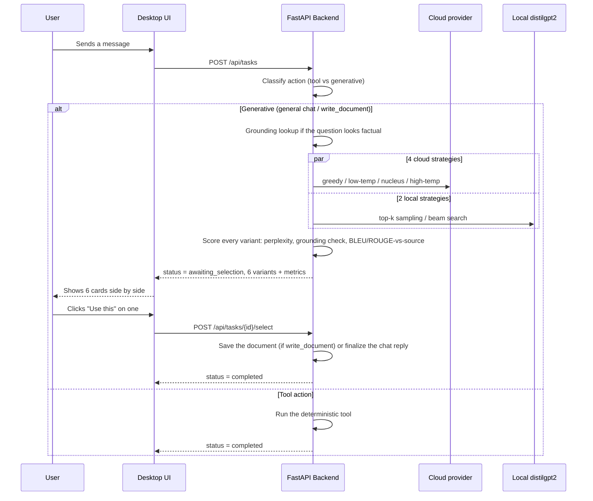
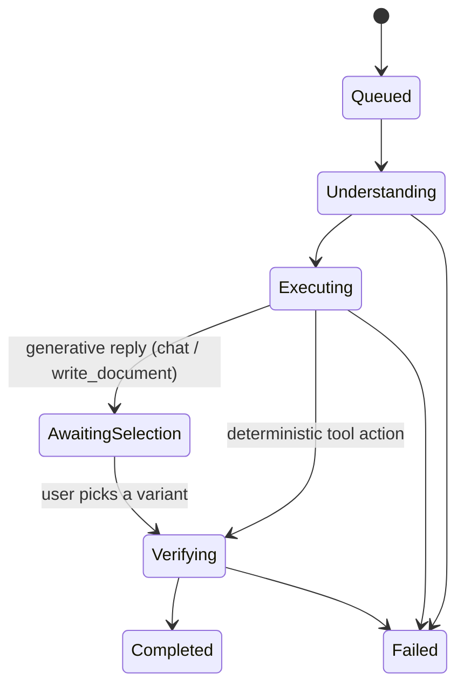

# AETHER Architecture and Design Notes

## Component diagram
```mermaid
flowchart TD
    U[User: text or voice] --> UI[Electron + React UI]
    UI --> API[FastAPI on localhost:8000]
    API --> AG[Agent: action classifier + sampling-variant engine]
    AG <--> CLOUD[Cloud AI API: OpenAI / Groq / Gemini\n(AETHER_PROVIDER)]
    AG <--> LOCAL[distilgpt2: top-k / beam search / perplexity\nrun locally - no hosted API exposes either]
    AG --> GROUND[Grounding: DuckDuckGo lookup + fact-verification pass]
    AG --> TR[Tool Registry / Controlled Dispatcher]
    TR --> DESK[Windows App Launcher]
    TR --> MUS[Spotify Search]
    TR --> FILE[File Search and Document Writer]
    TR --> NOTE[Notes and Reminders]
    API --> STT[faster-whisper local STT]
    API --> DB[(SQLite Task History)]
    NOTE --> FS[(Local Notes Folder)]
    FILE --> OUT[(Output Folder)]
```

## Generative-reply lifecycle (chat / document writing)
A tool action (open an app, set a reminder, search files) is deterministic - one call, one
result. A generative reply isn't: it runs 6 sampling strategies in parallel and waits for
a human pick before anything is finalized or saved.


## Task lifecycle (state machine)


## Data and trust boundaries
- The Electron UI communicates only with the local backend (`127.0.0.1:8000`).
- The backend calls one configured cloud AI provider (OpenAI, Groq, or Gemini - 
  `AETHER_PROVIDER` in `backend/.env`) over HTTPS for text generation, and a small local
  model (`distilgpt2`) for the two decoding strategies no hosted API exposes.
- Model output is treated as untrusted data. It selects from predefined actions; it does
  not provide executable code, and no generative reply is saved or shown as final until
  a human picks it from the 6 variants.
- Tool arguments must be validated by the tool implementation.
- API keys live only in the gitignored `backend/.env` and are sent only to their own
  provider's API - never logged, never sent anywhere else.
- External websites and media providers (DuckDuckGo lookups, Spotify search) are outside
  the app's own trust boundary; their results are treated as untrusted reference material,
  not instructions.

## Important implementation note
The LLM does not itself operate the mouse, keyboard or operating system. It proposes a
structured action; the application code decides whether that action is allowed and
invokes a specific handler. Pretrained models are used as-is through each provider's API
 - this project does not train, fine-tune, or implement attention/transformer internals
from scratch (see the README's syllabus-alignment table for the honest scope of what is
and isn't demonstrated in code).
