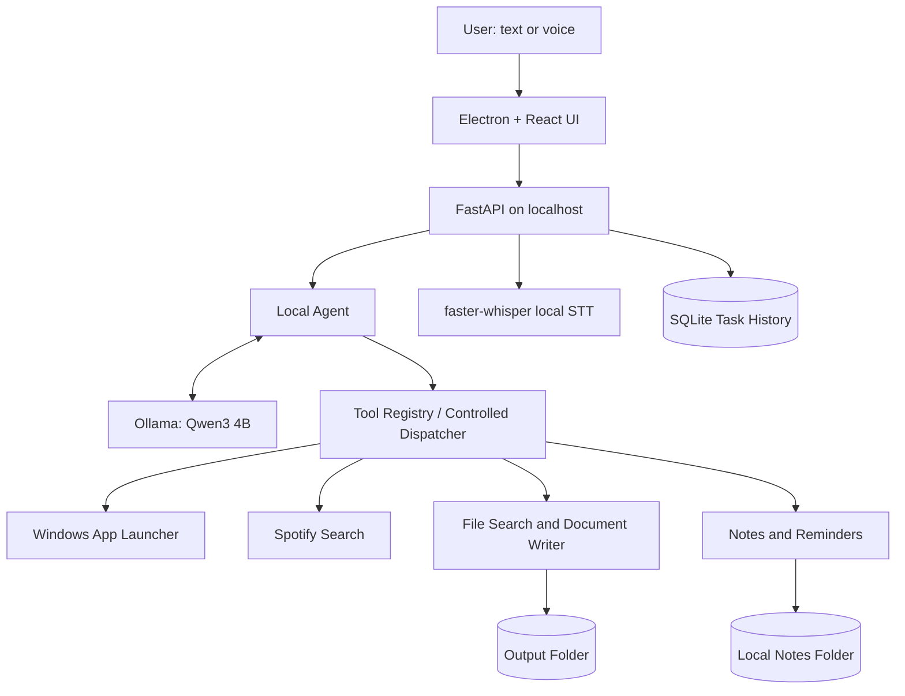
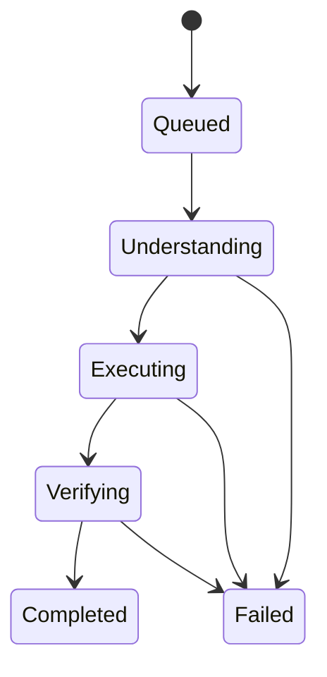

# AETHER Architecture and Design Notes

## Component diagram

## Task lifecycle

## Data and trust boundaries
- The Electron UI communicates only with the local backend.
- The backend calls the local Ollama service on `127.0.0.1:11434`.
- Model output is treated as untrusted data. It selects from predefined actions; it does not provide executable code.
- Tool arguments must be validated by the tool implementation.
- External websites and media providers are outside the local-only AI boundary.

## Important implementation note
The LLM does not itself operate the mouse, keyboard or operating system. It proposes a structured action. The application code decides whether that action is allowed and invokes a specific handler.
